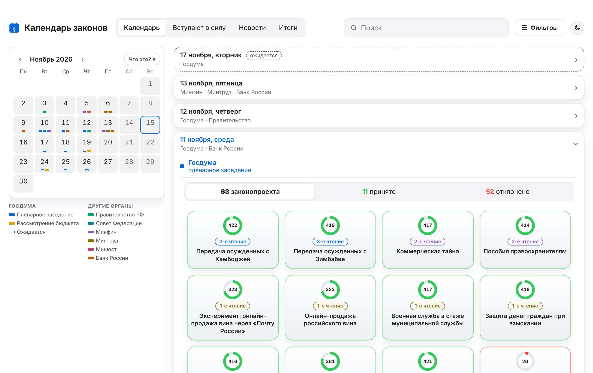

# Календарь законов

**Что приняла Госдума сегодня и что из этого коснётся лично вас — простым языком, по официальным источникам.**

👉 **<https://ruslan7121.github.io/kalendar-zakonov/>** — работает на телефоне и компьютере, без регистрации, в светлой и тёмной теме.
📱 **В Telegram:** [@kalendar_zakonov_bot](https://t.me/kalendar_zakonov_bot) — тот же сайт как мини-приложение.



## Что это

Госдума, Совет Федерации, Правительство, министерства и Банк России публикуют решения в виде стенограмм, таблиц голосований и PDF-файлов. «Календарь законов» собирает их в одном месте и раскладывает по дням: **что** рассматривали, **как** голосовали (итог, голоса фракций, время), **о чём** законопроект («Суть» и «Кого коснётся») и **когда** закон начнёт действовать.

> **Главное правило проекта:** только официальные источники (sozd.duma.gov.ru, vote.duma.gov.ru, kremlin.ru, publication.pravo.gov.ru и другие). Если в источнике чего-то нет, поле остаётся пустым. Ничего не додумывается.

| Раздел | Что показывает |
|---|---|
| **Пленарные заседания** | каждый день заседаний: законопроекты, голосования, итоги за день, неделю, месяц, год |
| **Работа госорганов** | документы и заседания органов власти по дням, неделям и месяцам |
| **Вступают в силу** | лента законов: что уже действует и что начнёт действовать |
| **Новости** | официальные новости органов власти |

Подробное описание функций — [docs/FEATURES.md](docs/FEATURES.md).

## Как это устроено

```
официальные сайты ──► pipeline/ (Python) ──► src/canvas.tsx ──► data/*.json ──► web/build.sh ──► gh-pages ──► сайт
                         ▲                     ▲ тексты ИИ-агента                  │
        расписание (GitHub Actions)             bill/, law/, day/, feed/, ics/ ◄───┘ web/extras.mjs
```

1. **Сбор.** GitHub Actions по расписанию запускают скрипты `pipeline/`: голосования, календарь, законопроекты, документы органов, новости.
2. **Тексты.** «Суть», «Кого коснётся» и метки пишет ИИ-агент по пояснительным запискам и официальным текстам ([AGENTS.md](AGENTS.md)).
3. **Проверка.** Схема данных, типы, стиль кода и тесты, включая браузерные (Chrome и WebKit). Битые данные не публикуются.
4. **Публикация.** Сборка `web/build.sh` кладётся в ветку `gh-pages` (GitHub Pages) скриптом `pipeline/publish/publish.sh`.

### Что где лежит

| Путь | Что там |
|---|---|
| `src/canvas.tsx` | интерфейс (React) и данные сайта в одном файле; `src/ui/` — вынесенные из него модули интерфейса |
| `data/` | данные сайта: `core.json`, `months/ГГГГ-ММ.json`, `index.json` (производные от `src/canvas.tsx`) |
| `web/` | сборка сайта: `main.tsx`, загрузчик данных `gdx.ts`, статические страницы, RSS и `.ics` (`extras.mjs`) |
| `pipeline/` | `collect/` сбор, `merge/` слияние и сборка данных, `check/` проверки, `publish/` коммит и публикация, `lib/` общая библиотека, `tools/` помощники; `run_daily.sh` — ежедневный прогон |
| `extracts/` | выжимки пояснительных записок и официальные тексты документов органов |
| `tests/` | `python/`, `js/` (включая браузерные), `fixtures/`, `run_all.sh` |
| `bot/` | служба уведомлений в Telegram (пока не подключена) |
| `docs/` | документация (ниже) |

Ветка `main` — исходники, `gh-pages` — собранный сайт (вручную не правится).

## Запуск у себя

Нужны Node.js 22+ и Python 3.10+ (для сбора данных ещё `curl` и `pdftotext`; полный список — `requirements.txt`).

```bash
npm ci
```

```bash
npm run build
```

```bash
npm run serve
```

Сайт откроется на http://localhost:8000. Проверки:

```bash
npm run typecheck
```

```bash
npm test
```

```bash
npm run check:style
```

Сбор данных за день: `bash pipeline/run_daily.sh 11.11.2026`. Подробнее — [docs/PIPELINE.md](docs/PIPELINE.md).

## Документация

| Файл | О чём |
|---|---|
| [AGENTS.md](AGENTS.md) | инструкция для ИИ-агента: что работает без него, что он делает, правила |
| [docs/PIPELINE.md](docs/PIPELINE.md) | конвейер: шаги, скрипты, переменные, публикация |
| [docs/FEATURES.md](docs/FEATURES.md) | возможности сайта, поиск и фильтры, подписки, ссылки с условиями |
| [docs/BOT_PROMPT.md](docs/BOT_PROMPT.md) | подробные правила текстов и интерфейса |
| [docs/ACCESS.md](docs/ACCESS.md) | доступ к официальным сайтам |
| [docs/REFACTORING.md](docs/REFACTORING.md) | устройство `src/canvas.tsx` и план отделения данных |
| [docs/STATUS.md](docs/STATUS.md) | что не заполнено (создаётся скриптом) |
| [docs/TOKENS.md](docs/TOKENS.md) | экономия токенов ИИ-агента |
| [docs/BOT.md](docs/BOT.md) | служба уведомлений в Telegram |
| [docs/CHANGELOG.md](docs/CHANGELOG.md) | журнал изменений |

## Источники

[sozd.duma.gov.ru](https://sozd.duma.gov.ru) · [vote.duma.gov.ru](http://vote.duma.gov.ru) · [duma.gov.ru](http://duma.gov.ru) · [council.gov.ru](http://council.gov.ru) · [government.ru](http://government.ru) · [kremlin.ru](http://kremlin.ru) · [publication.pravo.gov.ru](http://publication.pravo.gov.ru) · [cbr.ru](https://www.cbr.ru) · [minfin.gov.ru](https://minfin.gov.ru) · [mintrud.gov.ru](https://mintrud.gov.ru) · [minjust.gov.ru](https://minjust.gov.ru)
